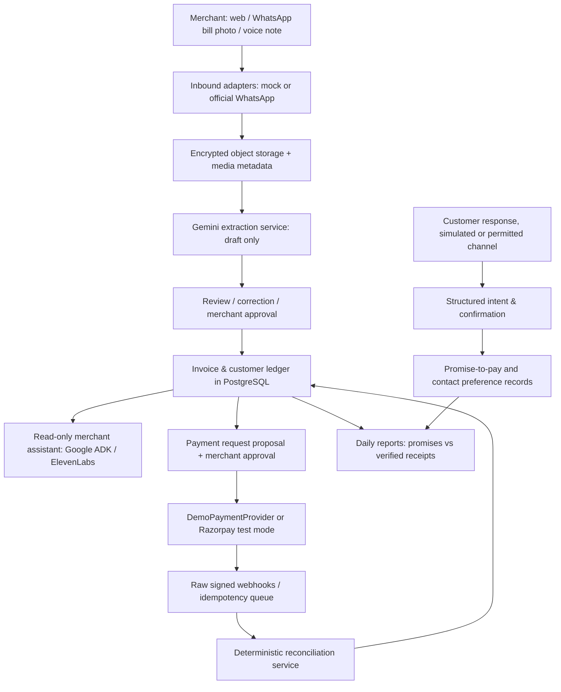

# Engineering architecture

## Recommended boundaries



## Repository layout recommendation
```
apps/web/                 # Next.js frontend
services/api/             # FastAPI controllers, auth, tenancy
services/api/domain/      # pure finance + workflow business rules
services/api/adapters/    # demo, WhatsApp, Gemini, voice, Razorpay
services/api/workers/     # async media ingestion & webhook handlers
services/api/tests/       # pytest
infra/                    # docker compose, Postgres, migration config
fixtures/                 # anonymised demo images & messages
```

## APIs (suggested, not official)
- `POST /v1/uploads` -> upload ID; `POST /v1/invoice-drafts/extract` -> extraction job; `GET /v1/invoice-drafts/{id}`.
- `PATCH /v1/invoice-drafts/{id}` -> edits; `POST /v1/invoice-drafts/{id}/approve` -> approved invoice (merchant authenticated).
- `GET /v1/customers/{id}/ledger`; `GET /v1/invoices/{id}`; `GET /v1/reports/today?date=YYYY-MM-DD`.
- `POST /v1/payment-intents` -> proposal; `POST /v1/payment-intents/{id}/approve` -> provider request.
- `POST /v1/webhooks/razorpay` (raw-body HMAC signature; provider event ID unique); `POST /v1/webhooks/whatsapp` (signature verification; media retrieval as separate job).
- `POST /v1/promises` -> records user-confirmed promise with evidence; `POST /v1/voice-tools/customer-balance` -> strictly read-only tool with limited fields.

## Database and authoritative state
See `../schemas/core.sql`. Use tenant-scoped authenticated records (`merchant_id`). Minimal entities:
- merchants/users/customers and channel consents;
- invoice drafts, issued invoices, invoice lines, uploaded source artefacts;
- payment requests, payment events, payments, payment allocations;
- explicit promises with date/time/method/confirmation source;
- conversations/messages, audit events and contact events.
All amounts integer INR paise; currency must match. Invoice balance is computed by query from confirmed allocations and adjustments, not a second editable mutable amount.

## Payment state machine
`created -> awaiting_payment -> authorised -> provider_verified/captured -> allocated`, plus `failed`, `expired`, `reversed`, `disputed`. A provider `authorised` status is not necessarily `captured/settled`. Do not equate pre-settlement with available bank cash. Show separate `verified captured` and `settled` where provider supplies both.

## Partial-payment allocation example
- Invoice I1 = 2,000,000 paise (₹20,000).
- Payment P1 = 500,000 paise allocated I1 => due 1,500,000.
- Payment P2 = 1,000,000 paise allocated I1 => due 500,000.
- Promise A = ₹3,000 Friday, B = ₹2,000 Monday -> due unchanged.
- P3 = 500,000 paise confirmed => due zero.

## Reconciliation algorithm, mandatory
1. Receive webhook `raw_body`, header signature and provider `event_id`; validate with provider verified HMAC using constant-time compare and configured webhook secret.
2. Persist ingestion envelope with `unique(provider, event_id)` and return 2xx for already-recorded events without reapplying.
3. Validate provider merchant/account, `payment_id`, invoice/payment-request correlation, INR currency and amount. Fetch provider payment when webhook status ambiguity exists.
4. Within one DB transaction, upsert payment by `(provider, provider_payment_id)` and apply immutable allocation(s) only for valid captured/verified state.
5. Lock targeted invoice/payment rows; enforce `allocated_total <= verified_payment_amount` and `applied_total <= invoice_due` unless explicit overpayment credit/adjustment business process is used.
6. Write audit records; queue reports updates. Out-of-order and duplicate events must not cause a second allocation.
7. Treat reversals/refunds as compensating entries. Do not silently delete historical evidence.

## Data extraction API: proposed contract
```json
{
  "source_file_id": "upload_001",
  "customer_name": "Murugan Stores",
  "invoice_date": "2026-11-20",
  "currency": "INR",
  "items": [{"description":"Rice bag","quantity":"2","unit_price_paise":120000,"line_total_paise":240000}],
  "subtotal_paise": 240000,
  "tax_paise": null,
  "total_paise": 240000,
  "uncertain_fields": ["tax_paise"],
  "source_language": "en",
  "needs_human_review": true
}
```
Return uncertain/unsupported fields as null with review flags, not guesses. Store evidence positions/source snippets if possible. Recalculate quantity * unit price with Decimal; do not trust model totals blindly. Tax compliance requires merchant's GST details and invoice classification (not automatically inferred).

## Agent tool design
`get_outstanding(customer_id)` / `get_today_promises(merchant_id)` / `get_today_received(merchant_id)` should be read-only, scoped and auditable. `create_invoice_draft`, `prepare_payment_link`, and `record_customer_commitment` have separate approval gates. The voice agent reads verified tool outputs; it does not authoritatively mutate ledger directly.

## WhatsApp provider options
- **Option A** (preferred for demo): official Cloud API owns messaging and a separate browser/ElevenLabs voice interface handles merchant voice. Permitted inbound image/voice-note media is delivered via webhook; test number required.
- **Option B**: ElevenLabs owns the connected WhatsApp number for text/voice notes, and webhook tools call our backend. Avoid trying to register the same number with multiple providers simultaneously. Test contact identity mapping and user-controlled messages.
- **Always** demo with a mock inbox if policy and account approvals are incomplete.

## Reliability/security
RBAC, row-level tenant filters, PII encryption/redaction, short-lived signed attachment URLs, raw webhook signature checks, job retries with dedupe, rate limiting, no mass outreach, privacy retention controls, consent/opt-out records, server-only credentials, secure logs, backup/restore plan.
